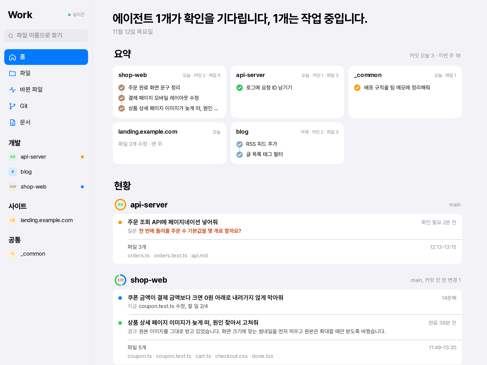
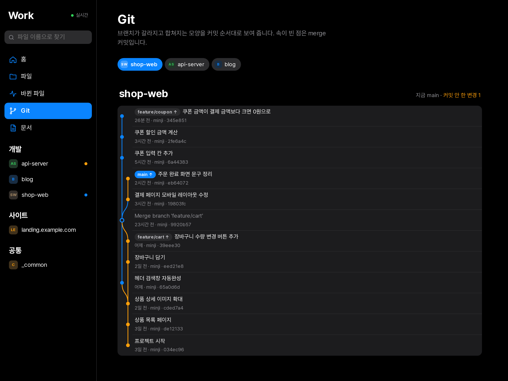
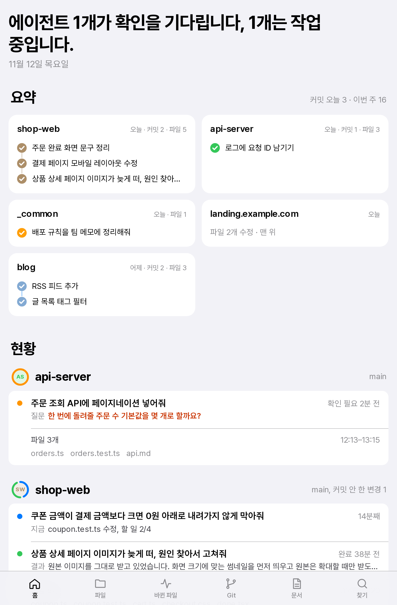

# Work Viewer

`~/Work` 같은 작업공간의 폴더·문서·바뀐 파일·git 커밋과 AI 에이전트(Claude Code) 상태를 브라우저에서 실시간으로 보는 읽기 전용 뷰어입니다. 에이전트에게 일을 시켜 두고 아이패드나 폰에서 결과를 바로 확인하려고 만들었습니다.



## 무엇을 보여 주나

- **홈**: 프로젝트별로 최근에 한 일(요약)과 지금 일하는 에이전트(현황 카드). 에이전트가 질문하거나 승인을 기다리면 강조됩니다.
- **파일**: 작업공간 폴더를 열어 가며 Markdown·코드·이미지·PDF 미리보기.
- **바뀐 파일**: 파일 추가·수정·삭제를 실시간으로.
- **Git**: 프로젝트별 브랜치·merge 커밋 그래프.
- **문서**: 프로젝트 `INDEX.md`의 문서를 제목·요약·검색어로 찾기.

<p>
  
  
</p>

스크린샷은 가짜 프로젝트로 만든 데모 작업공간입니다.

에이전트 부분은 herdr로 띄운 Claude Code 창을 읽습니다. herdr가 없어도 나머지 화면은 그대로 씁니다.

## 빠른 시작

[Bun](https://bun.sh)이 필요합니다.

```sh
mkdir -p ~/Work/Projects && cd ~/Work/Projects
git clone https://github.com/gyeolhwi/work-viewer.git
work-viewer/scripts/install.sh --root ~/Work --port 7320 --skills
```

`http://127.0.0.1:7320`을 엽니다. 다른 기기에서 보는 방법과 운영 명령은 [설치 가이드](docs/guide/install.md)에 있습니다.

## 문서

- 가이드: [설치·실행과 다른 기기에서 보기](docs/guide/install.md), [화면 구성과 용어](docs/guide/screens.md)
- 명세: [서버 구조·API·파일 감시와 에이전트 요약](docs/spec/server.md)
- 전체 목록: [INDEX.md](INDEX.md)

함께 들어 있는 Claude Code 스킬:

- `skills/work-setup` — 작업공간 구조(README·INDEX·AGENTS·docs)를 세팅하고 뷰어를 설치합니다.
- `skills/docs-tidy` — docs 문서에 머리말을 붙이고 `INDEX.md`를 만듭니다.

## 라이선스

MIT
